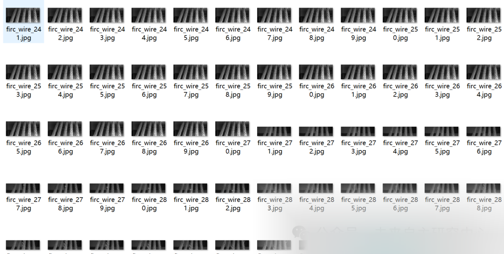
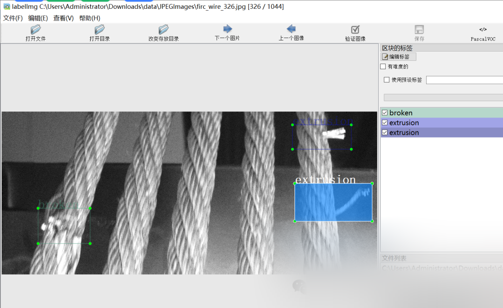

# Rope Defect Detection Dataset VOC+YOLO format with 1044 images in 3 categories

Dataset format: Pascal VOC format + YOLO format (txt file without split path, only containing jpg images and corresponding VOC format xml files and yolo format txt files)

Number of images (number of jpg files): 1044

Number of annotations (number of xml files): 1044

Number of annotations (number of txt files): 1044

Label category count: 3

Annotation category names: ["broken", "extrusion", "twist"]

Number of boxes labeled in each category:

Broken frame count = 133

Extrusion frame count = 812

Twist frame count = 253

Total frame count: 1198

Using labelImg:

Annotation rules: Draw a rectangle around the category.

Important Notice: No

Special : This dataset does not guarantee the accuracy or precision of the trained models or weight files. The dataset is provided with accurate and reasonable annotations only.

Image Preview:

Annotation example:

## Payment

Here is a pay link on Stripe ( https://buy.stripe.com/3cs8yP7sY87d0vu9AB ). Please contact me lonlonago@foxmail.com after funding $89, and I will send you a complete data files , thank you!

